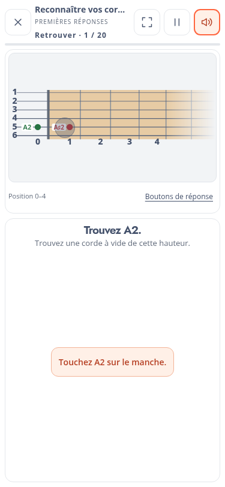
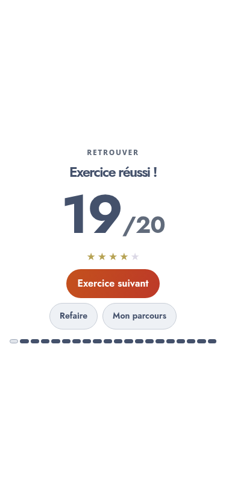
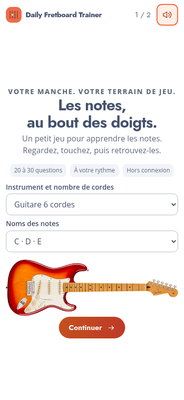

# Daily Fretboard Trainer — v0.10

## Des parties plus courtes

Chaque découverte donne désormais deux exercices indépendants : **Nommer**, puis **Retrouver**. En guitare six cordes standard, les onze concepts du pilote donnent donc vingt-deux exercices, tous accessibles dès le départ. La découverte du concept n’est pas répétée entre les deux exercices.

Les séries ordinaires contiennent 20 à 24 questions ; les bilans vont jusqu’à 30. Les séquences musicales restent à la fin des exercices « retrouver » : quatre à six notes supplémentaires, avec au maximum 30 réponses en tout. Une erreur n’ajoute plus de question à la file. Elle reste enregistrée pour la révision accessible depuis le parcours.

**Arbitrage :** l’ancienne règle « trois répétitions de chaque position dans chacun des deux sens » aurait recréé des séances trop longues. Elle cède devant la nouvelle limite de 30. Les tirages couvrent chaque position puis recommencent dans un ordre mélangé. Les grands bilans ne prétendent donc plus démontrer trois réussites par position en une seule séance.

Les deux diagnostics avancés sont eux aussi séparés. Il n’y a plus d’enchaînement automatique avec sept recherches de familles après le bilan.

## Un retour visuel bref

- Pastilles au tiers droit de la case ; noms au tiers gauche, sur la même corde, avec une petite capsule blanche arrondie.
- Chiffres des cordes et cases plus grands et en gras.
- Aucune réponse révélée avant l’essai dans « Quelle est cette note ? ».
- Une erreur montre le choix en rouge et les emplacements acceptables à **la hauteur demandée** en vert. E2 et E4 restent distincts.
- Pour une erreur sur la roue, celle-ci indique également le mauvais et le bon nom. Le manche montre une position réelle correspondant au mauvais nom, choisie au plus près de la hauteur cible ; ce n’est pas présenté comme un toucher de l’élève.
- Disque local au point de contact, qui disparaît en environ 340 ms. L’encadrement de case est retiré ; un indicateur circulaire reste disponible au clavier.
- Fin des commentaires textuels visibles, du bouton Continuer, de l’indice et de « Mauvais toucher ? ».
- Passage automatique après 500 ms si juste, 1 seconde si faux, y compris dans la séquence musicale. La pause suspend cette attente.

## Instructions, audio et résultats

À la première rencontre d’un format, l’écran annonce **Nouvel exercice !**, donne un titre explicite, une consigne courte et un exemple vectoriel. Les sensations d’intervalles restent expliquées avant leur découverte.

Les questions ne jouent plus la note cible. Une mauvaise réponse reste silencieuse ; une bonne réponse joue sa note. Les exemples des micro-leçons et l’accordage peuvent toujours être écoutés volontairement.

Le son par défaut est une **guitare électrique clean synthétisée** ; choisir une basse sélectionne automatiquement une **basse électrique synthétisée**, y compris pendant la configuration initiale. Les timbres sont produits sur l’appareil, sans téléchargement d’échantillons. Leur rendu sur les haut-parleurs d’un téléphone reste à évaluer à l’oreille.

Les résultats se concentrent sur le score, les petites étoiles et les boutons immédiatement placés dessous. Le bouton principal propose l’exercice suivant après réussite, sinon de réessayer. Les deux actions secondaires restent discrètes.

## Configuration initiale

La page explicative de la v0.6 sert de base au nouvel accueil, adapté au choix actuel d’instrument, aux séries courtes et au fonctionnement hors connexion. Le formulaire et ses actions sont regroupés au centre ; les éléments secondaires se réduisent sur les écrans courts. Le `tuner-label`, le `figcaption` et la bordure du bloc de cordes sont retirés.

**Logo en attente :** aucun fichier du nouveau logo n’accompagne le dernier message reçu. Le logo actuel est conservé en attendant la pièce jointe.

## Validation et livraison

- Vérification syntaxique de tous les modules et tests Node.
- Parcours des vingt-deux exercices standard dans Chromium, découvertes et suites musicales comprises.
- Six instruments sur cinq formats pour le cadrage et les réponses accessibles.
- Configuration initiale des six instruments sur huit formats, sans boutons cachés.
- Tests ciblés des sons, des temporisations réelles, des corrections, de la stabilité de la roue et des résultats sur cinq formats.
- Diagnostics séparés, accordages alternatifs, import/export, purge des anciennes versions v0 et démarrage hors ligne.

La recette utilise Chromium. Elle ne remplace pas un essai tactile et auditif sur tes téléphones habituels, notamment Safari/iOS.

Le ZIP FTP contient uniquement l’application. Décompresser et copier **son contenu** dans `adh-pwa/v0.10/`, puis ouvrir `https://media.lecompositeur.com/adh-pwa/v0.10/`. La mise en ligne FTP reste à effectuer. Comme prévu pour les versions v0, cette livraison repart avec une progression vierge en conservant l’instrument et les préférences.
