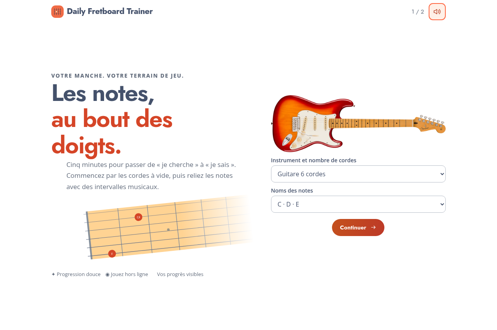
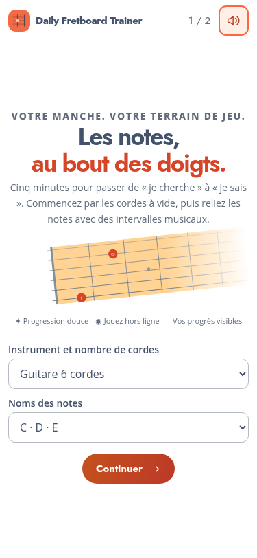

# Daily Fretboard Trainer — v0.11

## Changements implémentés

- Le titre désigne le sujet ; le sous-titre désigne la méthode. Par exemple : **Les cordes à vide / Nommer les cordes**, puis **Les cordes à vide / Retrouver les cordes**. Autre exemple : **La note B / Nommer les notes**. Les noms suivent la notation choisie. Les intervalles restent dans les introductions.
- Les titres des activités sont construits depuis un sujet explicite, indépendant du mode de réponse ; les identifiants et le contenu pédagogique restent stables dans cette livraison.
- Les noms des pastilles flottent à côté du point, avec une capsule arrondie, sur la même hauteur de corde. Un espace de 6 pixels sépare la capsule et la pastille. Le texte peut dépasser les limites d’une case. Il passe de l’autre côté si le bord gauche empêcherait sa lecture.
- L’indicateur tactile s’élargit jusqu’à environ 96 pixels pendant son fondu de 420 ms. Le rectangle de focus et la surbrillance tactile native sont supprimés du manche. Un petit repère circulaire reste disponible au clavier.
- Les Paramètres proposent **Guitare acoustique**, **Guitare électrique clean**, **Basse électrique clean**, et **Automatique**. Automatique conserve l’adaptation guitare/basse. Le choix explicite s’applique aussi aux écoutes de configuration, est sauvegardé et inclus dans les exports. Les trois timbres sont synthétisés localement.
- L’accueil reprend le texte de la capture : « Cinq minutes pour passer de “je cherche” à “je sais”… », l’accent orange, le manche incliné et les trois bénéfices. Les contrôles restent regroupés au centre, avec une composition adaptée aux petites hauteurs et sans défilement de page.
- Changer CDE / Do–Ré–Mi pendant la configuration actualise les étiquettes du schéma sans recréer le nœud image de l’instrument.

## Résultats et transitions : propositions à choisir

Voir [les propositions détaillées](PROPOSITIONS-RESULTATS-TRANSITIONS.md). La fiche de résultat actuelle reste conservée. Aucun nouveau système de points, bonus ou record n’a été ajouté sans validation.

## Vérification

Vérifications syntaxiques et tests Node ; tests Chromium des titres et de la notation, conservation du nœud image, persistance des timbres, espacement des capsules, configuration des six instruments sur huit formats, cadrage du manche, retours et temporisations. Vérification du dossier FTP et du démarrage hors ligne.

Les tests automatiques ne remplacent pas un essai auditif et tactile sur les appareils réels.

## Installation

Copier le contenu de `downloads/daily-fretboard-trainer-v0.11.zip` dans `adh-pwa/v0.11/`, puis ouvrir `https://media.lecompositeur.com/adh-pwa/v0.11/`.

La copie FTP reste manuelle. Comme pour les autres versions v0, la progression est réinitialisée au changement de version ; l’instrument et les préférences sont conservés. Le nouveau logo reste en attente de son fichier.
