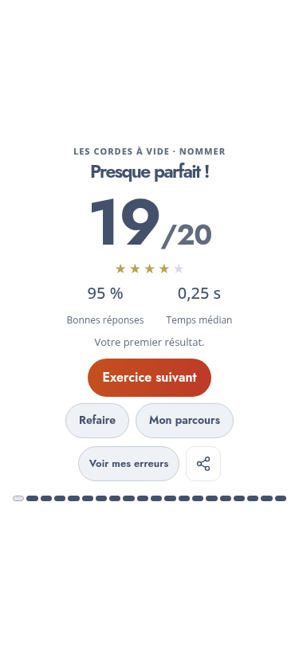
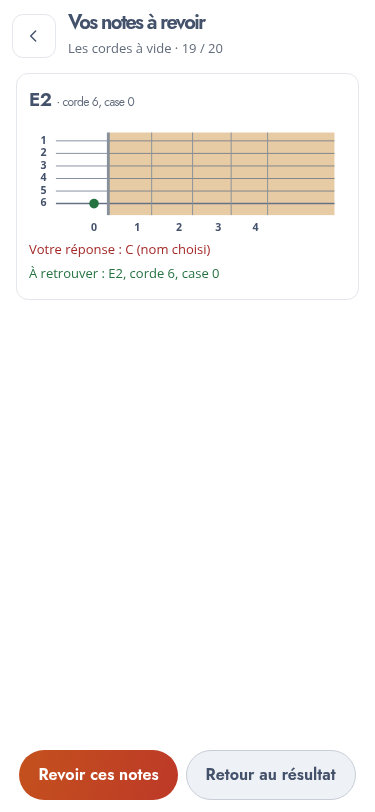

# Daily Fretboard Trainer — v0.12

## Résultats

La fiche conserve le score au premier plan et les étoiles discrètes. Elle affiche désormais le pourcentage de premières réponses correctes et le temps médian des réponses correctes sans aide. Sans réponse correcte chronométrable, le temps est remplacé par un tiret.

Les records sont comparés **uniquement au même exercice**, à l’intérieur de la configuration instrument/accordage courante. « Nommer » et « retrouver » restent deux exercices différents. Une meilleure précision prime sur la vitesse ; à précision égale, un meilleur temps médian peut établir un record de fluidité. Le premier résultat est présenté comme tel. Les erreurs corrigées ne remplacent pas le premier résultat.

Les révisions ciblées distinguent aussi l’exercice d’origine et le groupe de positions révisées, pour éviter de comparer deux séries portant sur des notes différentes.

« Voir mes erreurs » ouvre une vue distincte avec les confusions, leur nombre, les hauteurs demandées, les numéros de corde/case et un diagramme. Pour une réponse par toucher, le mauvais emplacement est rouge et le bon est vert. Pour une réponse par nom, on affiche le nom choisi sans inventer l’octave qu’aurait imaginée l’élève.

« Revoir ces notes » lance une série de 20–30 questions uniquement sur les positions manquées, en conservant le type de question. Les altérations du préambule d’accordage restent disponibles dans la roue lorsqu’elles doivent être révisées. Sans erreur, « Mes réponses » récapitule les positions travaillées.

Le bouton de partage crée une carte PNG du résultat, sans identité ni historique personnel. Le partage natif est proposé sur les navigateurs compatibles ; ailleurs, le bouton télécharge l’image. Rien n’est envoyé automatiquement. L’annulation du partage est silencieuse.

Les points et bonus de temps restent réservés au futur mode Arcade, conformément à la proposition retenue pour le mode Apprentissage.

## Transitions et chronométrage

Après les micro-leçons et au lancement des activités, l’écran de préparation occupe toute la hauteur et toute la largeur, sur un fond bleu-gris uniforme. Le texte **« À vous de jouer ! »** apparaît, s’agrandit et disparaît en 1,5 seconde. La roue de chargement est supprimée. Pause, sortie et Muet restent accessibles ; une pause suspend la durée restante et l’animation.

La question est rendue après la préparation. Le chrono démarre une fois ce rendu prêt, sans inclure les 1,5 seconde. Entre les questions, le court fondu d’apparition est également exclu du temps de réponse et les réponses sont bloquées jusqu’à la fin de cette apparition. Les délais de correction restent de 500 ms si juste et 1 seconde si faux.

Autres transitions : fondu et léger déplacement horizontal entre les étapes de configuration, apparition ciblée de l’image lors d’un changement d’instrument, fondu des consignes et nouveaux marqueurs, légère impulsion verte après une bonne réponse, apparition des résultats et du panneau de détails. La roue et les zones tactiles restent immobiles. **Aucun déplacement animé du repère de lecture de la suite musicale n’a été ajouté.**

Le réglage système « réduire les animations » supprime les déplacements et le zoom. La préparation conserve ses 1,5 seconde avec un simple fondu. Les animations utilisent principalement l’opacité et les transformations ; le flou de pause reste statique.

## Écouter le son sélectionné

Un bouton-icône à côté du sélecteur de timbre permet d’écouter une courte suite de trois notes avec le choix courant. Il respecte Muet et devient disponible dès que le son est réactivé. Les notes sont arpégées, sans superposition.

## Vérification et limites

- Tests Node : calcul des résultats, séparation des records entre exercices et directions, ordre précision/vitesse, exclusion des reprises et temps aidés, comparaison des révisions ciblées.
- Chromium : durée d’introduction, pause/reprise, exclusion de la préparation et du fondu des questions du chrono, révision ciblée, record, export PNG et préécoute.
- Fiche de résultat contrôlée sur six formats ; configuration sur six instruments et huit formats.
- Parcours complet des vingt-deux exercices, import/export et démarrage hors ligne.

Les temps visibles dans les captures de recette proviennent de l’horloge de test et ne représentent pas les performances d’un élève. Le partage natif dépend du navigateur et reste à essayer sur les téléphones habituels ; le téléchargement PNG a été vérifié.

## Livraison

Copier le contenu de `downloads/daily-fretboard-trainer-v0.12.zip` dans `adh-pwa/v0.12/`, puis ouvrir `https://media.lecompositeur.com/adh-pwa/v0.12/`.

La copie FTP reste manuelle. Les progrès et records sont remis à zéro entre versions v0 ; les préférences sont conservées. La conservation entre mises à jour stables reste prévue pour la v1.
