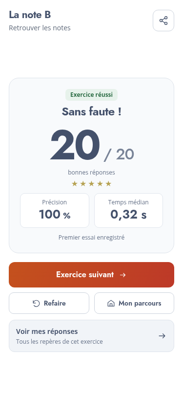
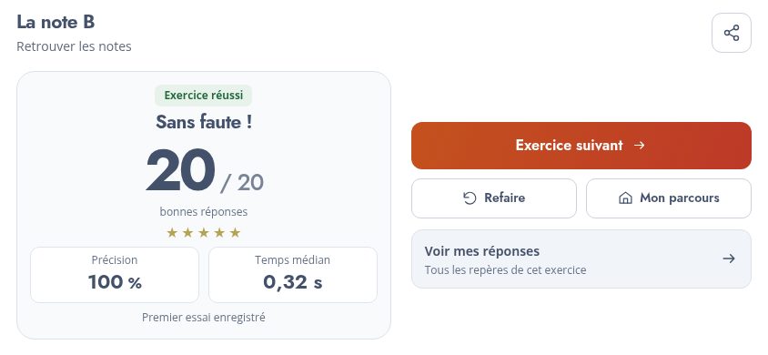

# Daily Fretboard Trainer — v0.13

## Fiche de résultat reconstruite

Le score « bonnes réponses / total » devient l’information dominante. Les étoiles restent discrètes ; précision et temps médian occupent deux cartes simples. Le record personnel reste comparé uniquement au même exercice et à la même configuration d’instrument/accordage. Un premier essai est annoncé comme tel.

L’action principale est « Exercice suivant » après réussite, « Mon parcours » à la fin, ou « Réessayer » après un échec. Les actions secondaires sont plus petites et sans accent. Un bouton distinct ouvre les erreurs ou le récapitulatif. Les diagrammes de correction, les révisions ciblées et le partage PNG restent disponibles.

La fiche s’adapte en deux colonnes en paysage et se compacte sur les petits écrans. Les boutons ont au moins 44 px de hauteur dans les formats vérifiés. Aucun défilement n’est requis sur ces six formats.

## Écoute et timbres

- L’icône enceinte dans « Votre instrument favori » est désormais un vrai bouton : elle joue l’accordage choisi, du grave à l’aigu, avec 230 ms entre les notes. Elle respecte Muet.
- L’acoustique est assombrie par un filtrage passe-bas plus doux dans l’aigu.
- La guitare électrique clean possède davantage d’harmoniques et un filtre plus ouvert. La basse conserve son timbre actuel.

La recette vérifie les signaux et leur programmation ; la préférence de timbre reste à confirmer à l’écoute sur les appareils habituels.

## Manche, accueil et transition

- Inlays discrets au centre des cases 3, 5, 7 et 9, puis deux repères à la douzième case, répétés à l’octave lorsque visibles. Ils restent sous les cordes et les pastilles.
- Suppression du footer global et des badges `.top-tag`.
- L’illustration oblique d’accueil dispose d’un emplacement de hauteur fixe selon le format ; elle ne décale plus les éléments voisins lors du choix d’instrument. La note grave est sur la corde à vide, case 0.
- Le zoom de « À vous de jouer ! » utilise une seule progression continue sur 1,5 seconde, accompagnée d’un fondu. Le chrono reste arrêté jusqu’à l’apparition effective de la question. Pause et réduction des animations sont respectées.

## Extraits réels dans les suites finales

Les activités utilisent maintenant de courts extraits identifiés et transposés uniquement lorsque toutes leurs hauteurs appartiennent à l’exercice. Les exemples du pilote standard comprennent « Ah ! vous dirai-je, maman », le Chœur des fiançailles, « Kuckuck », « The Entertainer », et des sauts mélodiques d’« Over the Rainbow » ou « Star Trek ». Leur micro-leçon permet d’écouter le modèle et d’ouvrir la source.

Les exercices à deux notes ne sont pas artificiellement enrichis. En l’absence de correspondance fiable, la séquence est annoncée comme une suite d’entraînement. Le rythme du modèle est joué mais n’est pas évalué. Les séries conservent leur limite de 20 à 30 réponses.

Voir [les sources et les règles de sélection](MELODIES-SOURCES.md), ainsi que les limites de droits avant commercialisation.

## Validation et livraison

Tests Node : compatibilité exacte des extraits avec les positions, cas six/sept cordes, transfert entre cordes, géométrie des inlays, filtres audio et inclusion des nouveaux fichiers dans le cache hors ligne.

Recette Chromium : écoute de l’accordage et Muet, stabilité de l’illustration sur quatre instruments, configuration sur six instruments et huit formats, continuité du zoom, chronométrage, résultats sur six formats, révisions et partage. Le parcours standard complet de vingt-deux activités et le paquet servi en sous-dossier hors connexion sont vérifiés.

Copier le **contenu** de `downloads/daily-fretboard-trainer-v0.13.zip` dans `adh-pwa/v0.13/`, puis ouvrir `https://media.lecompositeur.com/adh-pwa/v0.13/`. La copie FTP reste manuelle. La progression v0 est remise à zéro entre versions ; les préférences sont conservées.
