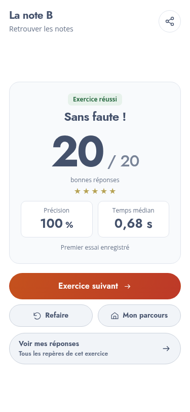
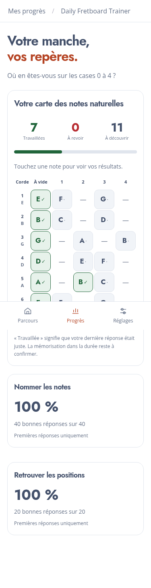

# Daily Fretboard Trainer — v0.14

## Cohérence visuelle

Les boutons des résultats retrouvent le style pilule partagé. La feuille d’entrée `ui.css` impose un ordre de couches explicite. `tokens.css` regroupe les fondations ; `components.css` définit les actions, leurs variantes et états, les panneaux et les champs. Les surcharges d’apparence propres aux pages ont été retirées des boutons communs.

Une galerie interne `ui-kit.html` et un contrôle automatisé des surcharges complètent cette migration. Les vues historiques conservent leur disposition ; l’objectif est de réutiliser le même composant dans chaque écran et les mêmes vues pour les exercices générés, sans multiplier les CSS par leçon.

Voir [le contrat du système de composants](DESIGN-SYSTEM.md).

L’espace avant la première ligne séparatrice des paramètres est corrigé, y compris après le bouton Plein écran.

## Réactivité et audio

Le manche répond à l’appui du doigt (`pointerdown`) plutôt qu’à son relâchement. Le retour tactile est indépendant du rendu de la question et ne bloque pas la saisie. Les notes jouées séparément ne coupent plus les notes déjà en résonance ; Muet, pause et sortie arrêtent toujours les sons.

Dans les suites musicales, un toucher peut passer à la note suivante pendant la confirmation correcte précédente, sans attendre ses 500 ms. La découverte accepte également les touches rapprochées. Dans les questions « retrouver », le délai de confirmation juste est réduit à 150 ms, suivi du court fondu de la nouvelle question ; celle-ci est jouable avant la fin du retour tactile et du son précédent. Le chrono de la nouvelle question démarre après son apparition. Les réponses fausses conservent une correction de 1 seconde ; les réponses de la roue gardent leurs 500 ms.

Les notes d’un modèle écouté restent séquencées pour que son rythme soit compréhensible. Les touches de l’élève peuvent, elles, se superposer acoustiquement.

## Exemples et repères

Le bouton **« Écouter l’exemple en rythme »** reste disponible dans « À vous de jouer la suite », avec le titre de l’extrait. Il rejoue le modèle transposé avec ses durées relatives et silences disponibles. Il respecte Muet. Les questions ordinaires restent silencieuses au lancement.

Les liens externes vers des partitions sans audio sont retirés du jeu. L’exemple audio est fourni localement ; les références documentaires restent dans [le dossier des sources](MELODIES-SOURCES.md). Les cellules provenant d’une simple référence d’intervalle conservent un rythme régularisé, annoncé dans ce dossier.

Le terme **« point d’appui »** disparaît de l’accueil. La corde grave sert toujours de référence interne pour calculer les intervalles du parcours ; l’élève n’a pas à apprendre ce terme technique pour commencer. Les micro-leçons continuent de nommer et de faire écouter les deux notes lorsque l’intervalle est introduit. Il ne faut pas présenter cette référence de calcul comme la tonique obligatoire de tout morceau joué sur l’instrument.

Les inlays du manche sont agrandis, avec une couleur discrète conservée.

## Progrès

La longue table de statistiques est remplacée par une carte compacte des notes naturelles : **vert avec ✓** pour une dernière réponse juste, **rouge avec !** pour une dernière réponse fausse, **neutre** pour une position encore à découvrir. Le nom reste visible et les cordes sont ordonnées de l’aigu au grave. Les notes altérées sont représentées par un tiret.

Trois compteurs et une barre résument cette carte. Toucher une note ouvre ses chiffres « nommer » et « retrouver ». Deux cartes distinctes récapitulent ensuite ces compétences. Les reprises ne gonflent pas les résultats. Une dernière réponse juste signifie « travaillée », sans prétendre démontrer une mémorisation durable.

## Mise en page des questions : propositions, sans implémentation

[Le document de propositions UX](UX-QUESTION-REPONSE.md) décrit trois pistes : rapprocher physiquement la consigne de l’action, utiliser le centre de la roue comme rappel graphique et stabiliser le rythme visuel. La recommandation est de tester les deux premières ensemble. Aucun déplacement des blocs de question/réponse n’est inclus dans cette livraison.

## Validation et livraison

- Tests Node : protection des composants, suivi par position exacte et saisie rapprochée de la suite, en plus des contrôles pédagogiques et audio existants.
- Chromium : commandes partagées, configuration six instruments/huit formats, résultats sur six formats, saisie rapide, résonance et Muet, lecture rythmée, carte de progrès, corrections, chrono et partage PNG.
- Parcours standard complet de vingt-deux activités ; paquet FTP en sous-dossier et démarrage hors connexion.

Copier le **contenu** de `downloads/daily-fretboard-trainer-v0.14.zip` dans `adh-pwa/v0.14/`. L’envoi FTP reste manuel. Comme prévu en v0, la progression repart à zéro entre versions et les préférences sont conservées.
