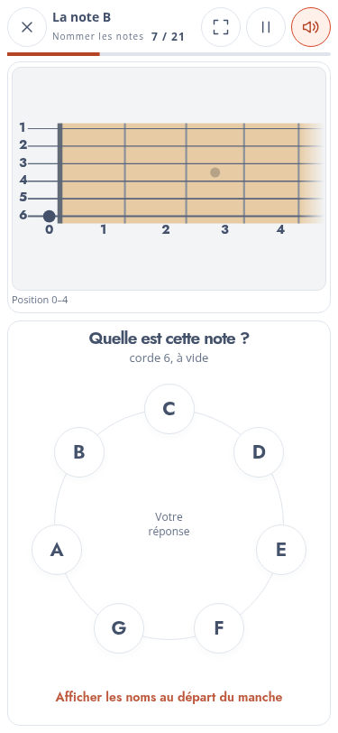
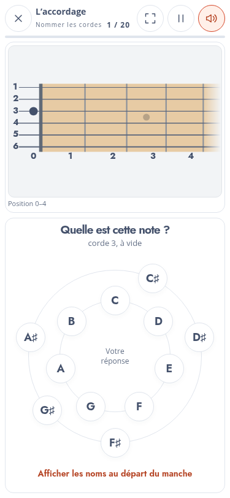
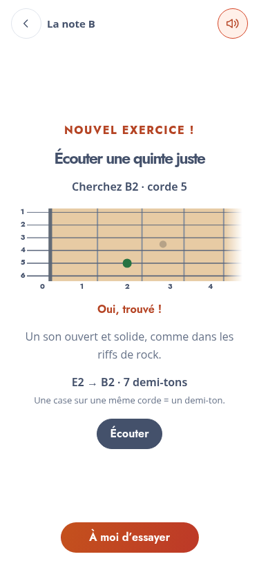
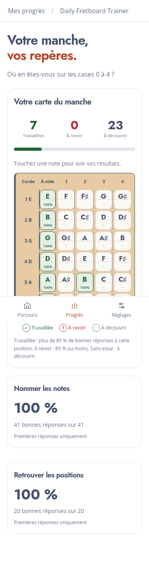

# Daily Fretboard Trainer — v0.15

## Périmètre

La disposition relative des blocs de question et de réponse est conservée. Le rapprochement proposé précédemment reste suspendu à la demande du porteur du projet. Les propositions pour « Comprendre mes erreurs » sont documentées séparément ; cette page n’est pas réorganisée dans cette livraison.

## Jeu continu et corrections superposables

Une réponse correcte ou incorrecte passe immédiatement à la question suivante. La roue reste utilisable ; aucune attente de 500 ms ou d’une seconde n’est imposée entre réponses. Le chrono est réinitialisé pour la nouvelle question, sans attendre le fondu de la correction précédente.

La correction possède son propre cycle visuel de 420 ms : point vert si juste ; mauvais emplacement et son nom en rouge, bonne réponse et son nom en vert si faux. Une bonne réponse ne rajoute pas de nom près du point. Plusieurs corrections peuvent coexister et disparaissent progressivement, sans intercepter les touches. Dans la roue, le nom choisi et la réponse correcte bénéficient également d’un retour coloré qui laisse les boutons actifs.

Pour une erreur de nom, l’octave que l’élève avait en tête n’est pas connaissable : le retour rouge de la roue fait foi ; le manche n’invente pas un emplacement absent de la zone. Les bonnes réponses restent sonores, les erreurs silencieuses ; les sons déjà lancés peuvent continuer à résonner. Pause, sortie et Muet les arrêtent.

Les suites musicales avancent également immédiatement après un toucher. Le bouton d’écoute du modèle en rythme est conservé. Les séries restent entre 20 et 30 questions, avec au plus 30 réponses en comptant la courte suite finale du pilote standard.

## Révision cumulative

Chaque activité de pratique réutilise les positions introduites dans les étapes précédentes du parcours. Les démonstrations et modèles musicaux conservent leur propre petit groupe de notes pour rester explicites.

La série réserve au minimum **20 % des questions** à la note visée par une nouvelle leçon d’intervalle. Cette proportion est garantie avant le mélange aléatoire ; un simple tirage pondéré aurait pu tomber sous 20 % dans une série courte. Le reste révise les notes déjà rencontrées, avec des répétitions permises. Si une activité présente plusieurs nouveaux repères simultanément, le quota porte sur ce groupe ; toutes les nouvelles positions sont représentées quand elles tiennent dans la série. Les premières cordes à vide sont réparties de manière équilibrée : six cordes ne peuvent pas avoir chacune 20 % d’une même série.

« Déjà apprises » désigne ici les étapes antérieures du parcours recommandé, pas une certification acquise grâce à une seule bonne réponse. Toutes les activités restent accessibles : sauter directement à une leçon tardive donne donc une série incluant ses prérequis, sans verrou de progression.

## Manche partagé et contrôles

- La zone des cordes à vide passe de 36 à 18 unités de dessin.
- Le fondu occupe **une demi-case** après la dernière case utile. Le manche utilise ainsi une plus grande partie de la largeur disponible.
- `neck-view.js` génère le même dessin pour l’exercice interactif, les micro-leçons, l’illustration d’accueil et les schémas d’erreurs. La géométrie, les inlays, le sillet, les frettes et les couleurs sont mutualisés dans `core.js`, `neck.css` et les tokens. Les inlays des petits schémas ont donc les mêmes proportions que ceux du manche interactif.
- La roue est maintenant un composant propre dans `answer-wheel.css`. Elle occupe presque toute la largeur d’un smartphone en portrait lorsque la hauteur disponible le permet ; sa taille est plafonnée à 340 px en paysage. Un second anneau apparaît uniquement pour les altérations nécessaires à l’activité. Les sept noms naturels restent sur le premier anneau.
- « Boutons de réponse » reste ouvert entre questions, activités et réouvertures de l’application, jusqu’à une fermeture manuelle. Le libellé devient « Masquer les boutons de réponse ». Le panneau reprend le bois, les cordes, le sillet et les séparations de cases. Sur un écran très court, son contenu reste défilable à l’intérieur du panneau pour rendre toutes les cordes accessibles.
- La préécoute du timbre dans les Paramètres joue désormais **toutes les cordes de l’accordage courant**, du grave à l’aigu, avec le son sélectionné.

## Découverte et micro-leçons

« Nouvel exercice ! » est placé au centre, en sur-titre. Les écrans de découverte et les micro-leçons ne sont pas précédés de la transition de lancement.

Les micro-leçons de recherche proposent un manche tactile : essais illimités, aucun point de réponse préaffiché, point vert uniquement après le bon toucher. Les tentatives ne sont pas notées et ne valident pas automatiquement la découverte qui suit. Les formats de démonstration « nommer » et le modèle musical conservent leur exemple graphique explicatif.

La découverte conserve elle aussi les essais illimités, sans bouton révélant d’emblée les cases. Les indications « plus grave », « un peu plus aigu », etc. se fondent sur la différence réelle entre la hauteur jouée et la hauteur attendue. Plusieurs formulations par distance évitent une phrase répétée à chaque essai. Une même hauteur sur la mauvaise corde produit un conseil spécifique.

La transition **« À vous de jouer ! »** dure désormais **une seconde** et effectue un zoom arrière. Elle est réservée à l’entrée dans les questions de pratique. La réduction des animations du système est respectée et cette seconde est exclue du temps de réponse.

## Indice et progression

Un bouton d’indice affiche les noms avec octave sur la première case de la zone : actuellement les cordes à vide. Les hauteurs viennent de l’accordage réel ; en guitare standard : **E2 A2 D3 G3 B3 E4**. L’indice disparaît après une réponse. La tentative est marquée comme aidée et ne sert pas au calcul de fluidité sans aide ; les sauvegardes acceptent ce nouveau type d’indice.

La carte Progrès affiche toutes les notes des cases 0 à 4, altérations comprises. Elle calcule la moyenne des premières réponses à **chaque position** :

- Plus de 85 % : **Travaillée**.
- 85 % ou moins : **À revoir**.
- Aucun essai : **À découvrir**.

Le pourcentage apparaît sur la case et les détails distinguent toujours « nommer » et « retrouver ». Les numéros de cordes et leurs noms sont alignés sur une seule ligne. Le dessin statistique reprend le bois, les cordes et les frettes, sans prétendre qu’un bon pourcentage démontre à lui seul une mémorisation durable.

## Apparence et phase 8

Le sélecteur propose **Claire / Sombre / Selon l’appareil**. Le dernier choix suit les changements du système sans recharger ni interrompre l’exercice. Les préférences restent enregistrées.

La connexion et la synchronisation de la progression entre appareils sont ajoutées au [document de phase 8](PHASE-8-IDEES.md), sans créer de compte ni de serveur dans cette version.

## Comprendre mes erreurs : pistes proposées

Voir [les propositions détaillées](UX-COMPRENDRE-ERREURS.md) : comparer explicitement « Demandé » et « Votre réponse », résumer la nature de la confusion, regrouper les répétitions et mettre en avant la révision ciblée existante. Ces changements de mise en page restent à valider.

## Validation et livraison

- Tests Node : mélange cumulatif et quota sur plusieurs accordages et tirages, avance immédiate après erreur ou réussite, corrections simultanées, indice et sauvegarde, moyenne à 85 %, thème système et géométrie partagée.
- Chromium : réponses espacées de 100 ms, roue active, corrections simultanées, indice retiré à la question suivante, reprise après sauvegarde aidée, boutons persistants, préécoute complète, thème système en direct, roue sur cinq formats, second anneau et découverte sans réponse révélée.
- Configuration sur six instruments et huit formats ; parcours complet des vingt-deux activités ; paquet FTP en sous-dossier et démarrage hors ligne.

Le score et les temps des captures proviennent de scénarios automatisés et ne décrivent pas un élève réel. L’essai tactile et sonore sur les téléphones habituels reste utile pour apprécier le confort et le timbre.

Copier le **contenu** de `downloads/daily-fretboard-trainer-v0.15.zip` dans `adh-pwa/v0.15/`. La copie FTP reste manuelle. Les progrès v0 sont réinitialisés entre versions ; les préférences sont conservées.
