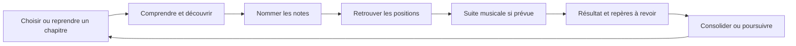

# Daily Fretboard Trainer — Game Design Document

**Version du document : 1.1 locale — 4 novembre 2026 (Europe/Paris)**

**Référence étudiée :** branche `sandbox/dft`, commit [`7e018e6`](https://github.com/csm-clem/ADH-reborn/commit/7e018e6c474d6dcf36589b4eba6de54aa7f86ab1).
**Statut :** description de conception et audit de l’existant ; recommandations soumises à arbitrage. Ce document n’atteste ni une sortie V1 ni une validation pédagogique ou utilisateur exhaustive.

## Sommaire

1. [Mode d’emploi et périmètre](#1-mode-demploi-et-périmètre)
2. [Vision et promesse](#2-vision-et-promesse)
3. [Publics et situations d’usage](#3-publics-et-situations-dusage)
4. [Piliers de conception](#4-piliers-de-conception)
5. [Boucles d’usage](#5-boucles-dusage)
6. [Modèle musical et instruments](#6-modèle-musical-et-instruments)
7. [Navigation et première expérience](#7-navigation-et-première-expérience)
8. [Architecture du parcours pédagogique](#8-architecture-du-parcours-pédagogique)
9. [Contrats des activités et réponses](#9-contrats-des-activités-et-réponses)
10. [Génération, difficulté et rythme](#10-génération-difficulté-et-rythme)
11. [Scores, étoiles et réussite du Parcours](#11-scores-étoiles-et-réussite-du-parcours)
12. [Progression, preuves et carte du manche](#12-progression-preuves-et-carte-du-manche)
13. [Erreurs, aides et révisions](#13-erreurs-aides-et-révisions)
14. [Finales et récompenses musicales](#14-finales-et-récompenses-musicales)
15. [Arcade : règles complètes](#15-arcade--règles-complètes)
16. [Succès et collection](#16-succès-et-collection)
17. [Interface, sensations et accessibilité](#17-interface-sensations-et-accessibilité)
18. [Audio](#18-audio)
19. [Données, sauvegarde et hors ligne](#19-données-sauvegarde-et-hors-ligne)
20. [Économie et relation commerciale](#20-économie-et-relation-commerciale)
21. [Périmètre actuel et extensions](#21-périmètre-actuel-et-extensions)
22. [Décisions du 4 novembre 2026](#22-décisions-du-4-novembre-2026)
23. [Plan de playtest et mesures](#23-plan-de-playtest-et-mesures)
24. [Registre courant](#24-registre-courant)
25. [Recette et entretien du GDD](#25-recette-et-entretien-du-gdd)
26. [Sources et glossaire](#26-sources-et-glossaire)

## 1. Mode d’emploi et périmètre

Ce GDD explique ce que le joueur apprend et fait, comment les systèmes se répondent, ce qui constitue une réussite, les limites des preuves produites et les décisions à tester. Il sert de référence commune à la conception, au développement, à la rédaction des contenus et à la recette.

Les étiquettes suivantes évitent de transformer une proposition en règle acquise :

| Étiquette | Sens |
| --- | --- |
| **Existant** | Comportement observé dans le code de référence, éventuellement accompagné de sa documentation publique. Ne garantit pas la présence dans la version live. |
| **Cadre documenté** | Intention produit formulée dans les documents publics ; son implémentation peut être incomplète. |
| **Hypothèse** | Effet attendu sur l’utilisateur, sans mesure suffisante. |
| **Recommandation** | Avis de game design proposé, sans modification automatique du jeu. |
| **À arbitrer** | Choix nécessitant une décision du responsable du produit. |

Le code actuel prime pour décrire le fonctionnement constaté. Une divergence avec une intention est signalée, jamais corrigée par une réécriture silencieuse de la règle. Les anciennes roadmaps, maquettes et spécifications restent des sources datées.

`AGENTS.md` a été consulté. Aucun fichier nommé exactement `PROJECT_STATE.md` n’a été trouvé dans l’arbre distant étudié ou la copie locale. Le présent GDD est établi à partir des sources publiques listées en section 26 ; les documents de suivi et de reprise internes ne sont pas reproduits.

**Limites de cette édition :** analyse documentaire et du code, sans observation d’élèves ni séance sur téléphone physique dans cette tâche. Les valeurs chiffrées de règles ne sont pas des données d’usage. Aucun taux de rétention, bénéfice pédagogique ou plaisir mesuré n’est inventé.

## 2. Vision et promesse

**Cadre documenté.** Daily Fretboard Trainer (DFT) est une application web installable d’apprentissage des notes du manche de guitare ou de basse. Elle adapte ses contenus à l’instrument et à l’accordage choisis.

**Promesse de conception :** aider le musicien à reconnaître et retrouver les notes avec des repères progressivement disponibles sans compter toutes les cases. L’utilisateur apprend sur une représentation du manche, peut entendre les bonnes réponses et réinvestit ses repères dans des suites musicales.

La réussite visée est une compétence utile : associer un emplacement, un nom et, quand la consigne l’exige, une hauteur exacte. Le score est un retour sur l’entraînement ; il ne constitue pas la finalité pédagogique.

Le jeu sur écran ne prouve pas à lui seul que le musicien retrouve ces notes sur son instrument réel, les mémorise plusieurs jours ou les utilise en improvisation. Le transfert physique et la rétention différée demandent des vérifications distinctes.

**Positionnement actuel :** outil individuel de pratique visuelle et sonore, complété par un défi Arcade. Aucune reconnaissance automatique de l’instrument joué n’est requise dans la boucle actuelle.

## 3. Publics et situations d’usage

Ces profils sont des **hypothèses de conception**, pas des segments validés par une étude.

| Profil | Besoin | Entrée utile | Point de vigilance |
| --- | --- | --- | --- |
| Grand débutant | Comprendre manche, corde, case, sillet et noms | Grand Débutant puis premiers repères | Une belle carte n’enseigne pas spontanément sa lecture. |
| Instrumentiste qui joue par formes | Donner un nom aux positions déjà utilisées | Progression guidée et pratique par corde | Reconnaître un dessin peut masquer l’absence de rappel autonome. |
| Musicien avec lacunes localisées | Réviser une zone ou un accordage | Pratique ciblée, carte des progrès, erreurs | Le catalogue complet peut rendre le prochain choix difficile. |
| Utilisateur déjà à l’aise | Consolider sa fluidité et se mesurer à soi-même | Bilans et Arcade facultatif | La vitesse à l’écran peut favoriser la maîtrise de l’interface. |

Usages possibles : courte séance dans un navigateur, pratique installée en PWA, entraînement sans instrument à proximité, préparation suivie d’un essai sur instrument. La durée idéale d’une séance reste à mesurer ; les nombres de questions actuels ne fixent pas une durée universelle.

## 4. Piliers de conception

1. **Exactitude musicale.** Ne pas confondre nom, octave, hauteur et emplacement ; calculer depuis l’accordage réel.
2. **Autonomie observable.** Distinguer découverte, réponse aidée et première réponse autonome.
3. **Apprentissage accessible.** La progression principale ne dépend pas d’une vitesse minimale et l’accès aux activités reste libre.
4. **Pratique cumulative.** Introduire un groupe de repères puis le mélanger à ceux déjà rencontrés.
5. **Feedback utile.** Montrer ce qui mérite une nouvelle tentative et proposer une action concrète après le résultat.
6. **Récompenses signifiantes.** Les succès rendent une compétence ou une étape visible ; la musique réinvestit les notes travaillées.
7. **Données dignes de confiance.** Une mise à jour, un changement d’accordage ou une statistique récente ne doivent pas fabriquer ou effacer une preuve.

**Recommandation transversale :** maintenir une distinction perceptible entre apprendre, consolider et se défier. Ajouter des points partout brouillerait cette distinction sans démontrer de bénéfice utilisateur.

## 5. Boucles d’usage

### 5.1 Boucle du Parcours



Le schéma représente la séquence pédagogique courante. Les activités restent accessibles directement ; les révisions et bilans n’exigent pas tous une découverte ou une finale musicale.

### 5.2 Boucle de consolidation

Consulter la prochaine séance → reprendre une difficulté ou une activité après une pause → répondre sans aide → consulter l’évolution récente → poursuivre quand les repères sont plus sûrs. Les recommandations actuelles sont simples ; elles ne constituent pas un algorithme complet de répétition espacée.

### 5.3 Boucle Arcade

Choisir un des quatre modes → nommer avant l’échéance → marquer des points et maintenir sa série → élargir le périmètre tandis que le délai décroît → perdre sa dernière vie → lire son résultat et ses records → rejouer si souhaité.

### 5.4 Boucle de motivation à long terme

Comprendre un nouvel espace du manche → constater ses progrès → obtenir éventuellement un succès ou une pochette musicale → choisir une nouvelle pratique. La collection soutient cette boucle ; elle ne doit pas rendre obligatoire une performance rapide pour apprendre.

## 6. Modèle musical et instruments

### 6.1 Instruments pris en charge

**Existant.** Les configurations de départ sont les suivantes, dans l’ordre interne des cordes physiques du bas du diagramme vers le haut :

| Instrument | Accordage standard proposé, de la corde physique grave vers l’aiguë |
| --- | --- |
| Guitare 6 cordes | E2 A2 D3 G3 B3 E4 |
| Guitare 7 cordes | B1 E2 A2 D3 G3 B3 E4 |
| Guitare 8 cordes | F♯1 B1 E2 A2 D3 G3 B3 E4 |
| Basse 4 cordes | E1 A1 D2 G2 |
| Basse 5 cordes | B0 E1 A1 D2 G2 |
| Basse 6 cordes | B0 E1 A1 D2 G2 C3 |

Une bibliothèque d’accordages et un éditeur permettent d’autres configurations. Un accordage réentrant conserve l’ordre des cordes physiques : on ne retrie pas les cordes selon leur hauteur sonore. Le profil est identifié par l’instrument et la liste exacte des hauteurs à vide.

### 6.2 Unités à ne pas confondre

| Objet | Exemple | Règle |
| --- | --- | --- |
| Classe de hauteur / nom | Mi, E | Revient à plusieurs octaves. |
| Hauteur exacte | E2, E4 | Le chiffre différencie les octaves sonores. |
| Emplacement | Corde 6, case 0 | Coordonnée physique sur le manche. |
| Unisson | B3 sur deux cordes différentes | Même hauteur exacte, plusieurs emplacements. |
| Octave | E2 → E3 | +12 demi-tons, fréquence doublée. |
| Deux octaves | E2 → E4 | +24 demi-tons, fréquence multipliée par quatre. |
| Enharmonie | C♯ / D♭ | Même classe de hauteur dans le tempérament égal utilisé. |

Une case ajoute un demi-ton sur une même corde. La hauteur de l’emplacement est `hauteur à vide + numéro de case`. La case 0 désigne une corde à vide, avant le sillet. La fréquence est calculée avec La4 = 440 Hz.

### 6.3 Notation et représentation

**Existant.** Notation internationale C D E F G A B ou latine Do Ré Mi Fa Sol La Si ; affichages dièses, bémols ou mixtes. L’affichage mixte emploie C♯, E♭, F♯, G♯, B♭ et leurs équivalents latins. Changer l’écriture ne change pas la hauteur ni le profil d’apprentissage.

La corde physique 1 est affichée en haut. Les vraies cases sont numérotées ; les points de repère fixes sont distingués de la pastille de question. Les diagrammes et questions utilisent le moteur de manche commun.

## 7. Navigation et première expérience

### 7.1 Configuration initiale

**Existant.** L’utilisateur choisit un instrument et un accordage ; le manche et le contenu suivent cette configuration. Un guide facultatif illustre les cordes, le sillet, les cases et les deux principaux gestes de réponse. Les réglages permettent notamment notation, altérations, timbre, son, thème et boutons de réponse.

**Objectif de première expérience :** comprendre une consigne et produire une première réponse voulue, sans devoir explorer tous les réglages. Le temps nécessaire et les abandons à cette étape ne sont pas encore mesurés dans cette édition.

### 7.2 Trois branches pédagogiques

| Branche | Fonction actuelle |
| --- | --- |
| Grand Débutant | Quatre cours : Votre instrument ; Le diagramme du manche ; Les noms des notes ; Nom, hauteur et octave. |
| Progression guidée | Niveau 1 composé de six étapes réutilisant les chapitres canoniques. |
| Pratique ciblée | Catalogue par zones, cordes, duos et mélanges ; accès direct au périmètre souhaité. |

Navigation pédagogique : branche → parcours → chapitre → activité. La reprise mémorise le contexte utile. Arcade possède son entrée propre. Progrès, Succès et Paramètres complètent les accès principaux.

Une action de prochaine séance facilite la reprise. Les gestes de navigation ne doivent pas capter le défilement du manche, les roues ou une commande interactive.

### 7.3 Accès et démarrage

**Cadre documenté et existant.** Les activités compatibles sont accessibles sans verrou de réussite. L’ordre est recommandé, non imposé. Aucun paramètre de prévisualisation n’est nécessaire pour voir le catalogue complet implémenté.

Le lancement commun affiche une préparation de **2 350 ms de temps actif**, hors chronométrage de la première réponse. La pause fige ce lancement. Les anciennes mentions d’une préparation d’une seconde ne décrivent plus le code étudié.

## 8. Architecture du parcours pédagogique

### 8.1 Périmètres disponibles

| Type | Étendue actuelle |
| --- | --- |
| Zones | I : 0–4 ; II : 4–8 ; III : 8–12 ; IV : 12–16 ; V : 16–20 ; VI : 20–24. |
| Cordes | Chaque corde sur 0–12 et chaque corde sur 0–24. |
| Duos | Chaque paire de cordes adjacentes, sur 0–12. |
| Mélanges | Toutes les cordes sur 0–12 ou 0–24. |

Les frontières partagées appartiennent à plusieurs contextes pédagogiques, mais une position physique ne devient pas deux positions dans la couverture globale. Un succès de chapitre reste lié à son contexte ; il n’est pas automatiquement validé par un autre chapitre.

Le nombre de chapitres dépend de l’instrument, de l’accordage et des familles réellement présentes. Le GDD ne fige donc pas un nombre unique de cours pour tous les utilisateurs. Pour `n` cordes, le catalogue complet génère `7 + 3n` périmètres : six zones, `2n` cordes, `n−1` duos et deux mélanges.

### 8.2 Progression par familles

**Existant.** Pour un périmètre donné :

1. Présenter les repères d’entrée et les cordes à vide lorsque le contexte le prévoit.
2. Introduire les familles naturelles disponibles en tenant compte des départs à vide et de l’accordage réel.
3. Pour chaque famille : découvrir ses emplacements, puis la nommer et la retrouver dans un mélange cumulatif.
4. Relier les naturels : même nom, autres positions, octaves et douzième case selon le contexte.
5. Introduire les familles altérées, y compris celles présentes à vide, puis leurs mélanges cumulatifs.

L’ordre est calculé, non une liste Mi–La imposée à toutes les basses et tous les accordages. Une corde à vide altérée peut être montrée avec l’accordage avant que l’enseignement de sa famille arrive après les naturelles.

Les activités de famille isolée existent encore comme formats et pour compatibilité. Le chapitre canonique courant emploie une découverte de famille suivie de deux activités cumulatives : Nommer et Retrouver. Il faut distinguer cette structure du simple catalogue historique de familles isolées.

### 8.3 Niveau 1 guidé

| Étape | Contenu principal | Rappel associé |
| --- | --- | --- |
| Vos premiers repères | Naturelles de zone I | — |
| Le long de votre première corde | Naturelles de la première corde physique du parcours, 0–12 | Synthèse naturelle de zone I |
| Une deuxième corde, les mêmes noms | Naturelles de la deuxième corde, 0–12 | Synthèse naturelle de la première corde |
| Compléter votre première zone | Altérations de zone I | Synthèse naturelle de la deuxième corde |
| Toutes les notes de votre première corde | Altérations de la première corde | Synthèse complète de zone I |
| Toutes les notes de votre deuxième corde | Altérations de la deuxième corde | — |

« Première corde » du parcours désigne ici la première traitée par le catalogue depuis le bas du diagramme ; ce n’est pas nécessairement la corde numérotée 1. Les mêmes objets d’activité et preuves sont réutilisés entre guidé et ciblé.

### 8.4 Cours et micro-leçons

Les cours expliquent un concept et proposent des interactions ou questions adaptées au profil. Visiter une page, répondre à sa question et réussir une activité évaluée sont des événements distincts. Une ancienne proposition de 24 micro-leçons est une source de conception, pas la preuve que le produit courant suit exactement ces 24 écrans.

## 9. Contrats des activités et réponses

| Format | Ce que voit / fait l’utilisateur | Réponse évaluée | Ce que cela peut prouver |
| --- | --- | --- | --- |
| Cours / démonstration | Lit, observe, essaie un exemple, répond aux interactions | Selon la page | Compréhension locale de l’exemple, pas maîtrise de tout le périmètre. |
| Découvrir | Cherche les emplacements d’une famille sur le manche | Trouver les positions du groupe | Exploration terminée, pas rappel autonome. |
| Nommer | Voit une pastille sur un emplacement, choisit un nom | Classe de hauteur dans les mélanges ; hauteur exacte dans les formats de famille / cordes à vide concernés | Association position → nom ou hauteur, selon contrat. |
| Retrouver | Lit une note et une contrainte de corde / hauteur, touche le manche ou un bouton | Position admissible dans le périmètre | Association nom / hauteur → emplacement conforme. |
| Révision / bilan | Revoit un ensemble de positions, sans nouvelle découverte obligatoire | Même sens de réponse pendant l’exercice | Réussite contextualisée et consolidation possible. |
| Finale musicale | Reproduit une suite en ordre | Hauteur exacte de chaque note ; emplacement admis dans le groupe | Suite accomplie, pas lecture rythmique ou maîtrise instrumentale. |
| Arcade | Nomme rapidement une position | Classe de hauteur avant échéance | Performance de défi dans ce mode et ce profil. |

**Règles de validité :**

- Une consigne de hauteur exacte ne valide pas E4 à la place d’E2.
- Une consigne de corde donnée ne valide pas une autre corde uniquement parce que le nom est juste.
- Une recherche de corde à vide exclut une note frettée, même de même hauteur.
- Les positions hors bornes et hors cordes du périmètre sont inadmissibles.
- Une démonstration est séparée des essais évalués ; si elle révèle la question évaluée, la réponse doit être marquée aidée.
- Le passage par une traduction de notation ne doit pas être présenté comme un test autonome de cette traduction.

## 10. Génération, difficulté et rythme

### 10.1 Taille des exercices

**Existant.** Les exercices usuels comportent **20 à 24 questions**. Les activités de rappel peuvent aller jusqu’à **30 questions**. Le nombre est calculé à partir du groupe de positions, avec un minimum de 20 pour les activités évaluées concernées.

Un exercice conserve un seul type de réponse : Nommer ou Retrouver. Les deux sens sont travaillés séparément et se rejoignent dans les preuves du chapitre.

Une grande liste de positions ne peut pas être certifiée couverte dans une seule série courte. Le générateur réutilise l’historique et privilégie les positions moins vues ; la couverture s’accumule entre séances.

La finale musicale ajoute généralement quatre à six notes à la série de Retrouver. Une erreur peut imposer de recommencer la chaîne : le nombre de gestes réel n’est donc pas borné par le seul nombre de questions évaluées.

### 10.2 Composition des mélanges

**Existant.** La nouvelle famille reçoit au moins **30 %** des questions du mélange lorsqu’il existe un ancien groupe à réviser. Le générateur vise habituellement 30–40 %, mais la couverture de toutes les positions nouvelles peut augmenter cette part. La règle exacte garantit un minimum, pas un plafond de 40 %.

Exemple : sur 24 questions, le minimum de 30 % donne `ceil(24 × 0,30) = 8` questions nouvelles. Les positions de la nouvelle famille sont d’abord couvertes ; le reste répartit anciennes et nouvelles réponses selon la composition disponible.

Le tirage cherche à équilibrer les réponses et à éviter plus de deux répétitions consécutives de la même classe, hauteur ou position selon le format, lorsque le groupe permet cette alternance. Il ne faut pas promettre une absence absolue de répétition dans un ensemble non discriminant.

### 10.3 Axes de difficulté

| Axe | Facile → plus exigeant |
| --- | --- |
| Étendue | Petite zone → corde complète → plusieurs zones / cordes |
| Vocabulaire | Naturelles → altérations → mélange chromatique |
| Relation | Position connue → nouvelle corde → unissons / octaves / transferts |
| Autonomie | Exemple / aide → réponse sans aide |
| Rappel | Groupe récent → cumul → retour après pause |
| Pression temporelle | Aucune condition de vitesse en Parcours → délai décroissant en Arcade |

**Recommandation :** éviter de faire monter simultanément étendue, vocabulaire et pression temporelle lors d’un premier contact. Ce principe est à tester ; il ne modifie pas les seuils actuels.

## 11. Scores, étoiles et réussite du Parcours

### 11.1 Précision et seuil

Une première réponse est le premier essai enregistré pour une question donnée, pas le premier essai de la vie du joueur. Les événements de reprise marqués `retry` sont exclus des métriques de première réponse.

```text
Précision = premières réponses correctes / premières réponses enregistrées
Nombre requis = plafond(nombre de questions attendu × 0,90)
Séance réussie = séance répondue entièrement et nombre correct ≥ nombre requis
```

| Questions évaluées | Bonnes réponses requises | Exemples |
| --- | ---: | --- |
| 20 | 18 | 18/20 = 90 % : seuil atteint. |
| 24 | 22 | 21/24 = 87,5 % : sous le seuil ; 22/24 ≈ 91,7 % : atteint. |
| 30 | 27 | 27/30 = 90 % : seuil atteint. |

**Existant.** La réussite affichée de séance se calcule sur la précision. La validation durable impose en plus l’absence d’aide sur l’ensemble des événements de la tentative et le respect du contrat de l’activité. Un résultat aidé à 90 % peut donc être « réussi » à l’écran sans constituer la preuve autonome requise pour terminer un chapitre.

Une correction n’efface pas l’erreur initiale. Le Parcours n’utilise ni vies consommables ni perte de points punitive ; échouer au seuil invite à réviser ou réessayer et ne ferme aucune activité.

### 11.2 Temps moyen

Le temps moyen porte sur les premières réponses **correctes, sans aide et au chronométrage interprétable**. Les erreurs et réponses aidées ne contribuent pas à cette moyenne. S’il n’y a aucun temps admissible, la valeur est absente, pas zéro.

Les introductions, la préparation et les pauses ne consomment pas le temps de réponse. La vitesse n’est pas une condition de réussite à 90 %.

**Interprétation :** une moyenne calculée sur seulement quelques bonnes réponses n’a pas la même portée qu’une moyenne sur toute la série. Toujours lire vitesse et précision ensemble.

### 11.3 Barème des étoiles

Barème local demandé le 4 novembre 2026, après clarification des intervalles :

| Étoiles | Critères |
| --- | --- |
| 0 | Plus de 10 erreurs, ou aucune réponse. |
| 1 | De 6 à 10 erreurs incluses. |
| 2 | De 3 à 5 erreurs incluses. |
| 3 | Au maximum 2 erreurs ; aucune vitesse exigée. |
| 4 | Au maximum 1 erreur et moyenne admissible ≤2 500 ms ; toutes les premières réponses disposent d’un temps admissible, sans aide. |
| 5 | Aucune erreur et moyenne admissible ≤1 000 ms ; toutes les premières réponses disposent d’un temps admissible, sans aide. |

La moyenne porte sur les bonnes premières réponses sans aide, aux temps interprétables, finis et positifs ou nuls. Pour quatre étoiles, le temps d’une réponse incorrecte doit aussi être admissible, bien qu’il n’entre pas dans cette moyenne. Les reprises sont exclues. Les erreurs sont comptées en nombre absolu, indépendamment de la taille de l’exercice. Les critères de quatre et cinq étoiles remplacent les trois étoiles quand ils sont satisfaits. Le seuil de séance réussie à 90 % reste distinct.

Une phrase courte indique les conditions manquantes pour cinq étoiles ; le popup détaille tous les niveaux. Les étoiles et l’information de record disposent d’un i cerclé en exposant. Les étoiles de rareté de collection restent un système distinct.

### 11.4 Résultats et records

La fiche présente bonnes réponses / total, précision, moyenne, étoiles et record personnel. Le détail montre les erreurs, la réponse choisie, la note attendue et son emplacement ; il permet une révision ciblée. Une carte PNG peut être partagée ou téléchargée.

Les records du Parcours comparent le même exercice, le même profil et le même contrat lorsque celui-ci est précisé. Une révision ciblée conserve une identité comprenant sa source et son groupe de positions. La priorité de comparaison est **précision**, puis **temps moyen** à précision égale. Améliorer sa vitesse en répondant moins juste n’est pas un nouveau record supérieur.

## 12. Progression, preuves et carte du manche

### 12.1 Quatre lectures distinctes

| Indicateur | Question à laquelle il répond | Limite |
| --- | --- | --- |
| Résultat de séance | Ai-je atteint 90 % dans cette série ? | La série ne couvre pas forcément tout le groupe. |
| Validation d’activité | Ai-je terminé ce contrat à seuil suffisant sans aide ? | Ne valide pas un autre contrat. |
| Couverture autonome | Quels emplacements ai-je correctement traités dans chaque sens sans aide ? | Une réussite ancienne ne prouve pas une rétention actuelle. |
| État récent de position | Comment se passent mes derniers essais sur cet emplacement ? | Mélange les deux sens ; n’est pas une certification de chapitre. |

### 12.2 Complétion d’un chapitre

**Existant.** Un chapitre de famille combine découverte enregistrée, validation de toutes ses activités et couverture autonome de ses positions de référence dans les deux sens. Un cours utilise son propre état de complétion. La progression guidée réutilise ces preuves canoniques ; elle ne les duplique pas.

Une preuve est attachée au profil instrument / accordage et au contrat de tâche. Changer l’accordage ne doit pas valider automatiquement des notes qui ne correspondent plus aux mêmes positions. Un changement purement visuel de notation ne crée pas de nouvelles hauteurs.

### 12.3 Carte des progrès

La carte représente les positions de 0 à 24, avec détails par emplacement et bilans Nommer / Retrouver. L’état récent utilise les **20 dernières premières réponses par emplacement, les deux sens réunis**. Les anciens agrégats sont un repli lorsqu’aucune nouvelle fenêtre n’existe.

| État | Règle actuelle |
| --- | --- |
| Nouveau | Aucune réponse disponible. |
| À revoir | Des réponses existent, sans satisfaire les états suivants. |
| Travaillée | Précision strictement >85 %. |
| Parfait | 100 % et au moins trois réponses correctes dans chaque sens. |

À 85 % exactement, la position reste À revoir. Un seul essai correct peut donner Travaillée à 100 %, mais pas Parfait. À 20 essais, il faut au moins 18 bonnes réponses pour dépasser 85 %. L’échantillon compte donc autant que le pourcentage.

Le calcul de cette carte n’exclut pas toutes les réponses aidées comme le fait la couverture autonome. **Travaillée ou Parfait ne signifie donc pas automatiquement « acquis sans aide ».** Les succès déjà obtenus et les validations historiques ne sont pas retirés par une baisse de cette fenêtre récente.

### 12.4 Persistance des preuves

Le journal détaillé courant est limité aux 250 dernières tentatives. Les preuves durables, couvertures et records sont conservés séparément pour survivre à cette limite. Une activité abandonnée n’est pas une séance terminée ; ses données éventuelles ne doivent pas être présentées comme une validation complète.

## 13. Erreurs, aides et révisions

### 13.1 Feedback d’erreur

**Existant.** La correction vise la cible concernée. Les explications distinguent notamment mauvais nom, mauvaise corde, hauteur d’une autre octave ou non-respect d’une consigne de corde à vide. Les questions et erreurs ne jouent pas une note susceptible de fournir la réponse suivante.

Les premières erreurs restent enregistrées. Les corrections ordinaires peuvent coexister visuellement avec la question suivante ; la dernière erreur d’une série dispose d’une correction différée avant la sortie. Le nombre de réponses n’est pas multiplié par ces effets visuels.

**Hypothèse à tester :** ce rythme réduit l’attente pour les utilisateurs à l’aise. Il peut aussi empêcher un débutant de comprendre l’erreur avant de lire la prochaine question.

### 13.2 Aides

Le modèle distingue notamment affichage des noms, écoute, consultation de cours et noms de cordes. Une aide est conservée dans l’événement de réponse. Une bonne réponse aidée ne devient pas une preuve de couverture autonome.

L’aide doit permettre de reconstruire le repère ; elle ne doit pas créer l’illusion d’un rappel indépendant. Les découvertes et démonstrations ont précisément le droit de montrer ce qu’une question évaluée doit ensuite vérifier.

### 13.3 Révision

Une erreur alimente une liste de positions à revoir, dédupliquée par position et sens, limitée à 200 entrées. Une réponse correcte sans aide en activité de révision peut retirer l’élément correspondant.

La navigation propose actuellement :

- une révision des erreurs après une dernière tentative échouée non encore résolue ;
- un retour sur les repères après au moins 24 heures depuis la dernière tentative pertinente, lorsqu’une activité réussie est disponible.

Ces règles s’appliquent au contexte de parcours, pas à un diagnostic complet de mémoire de toutes les positions. Une activité réussie mais juste au-dessus du seuil peut encore contenir des lacunes non recommandées en priorité.

## 14. Finales et récompenses musicales

### 14.1 Rôle et déroulement

**Existant.** Les activités ordinaires de Retrouver peuvent se terminer par une courte suite musicale ; les rappels n’imposent pas cette étape. Le joueur reproduit les notes dans l’ordre. Une erreur remet l’index de la chaîne à zéro. Les erreurs de motif sont conservées séparément de la précision des questions évaluées.

La validation porte sur la **hauteur exacte** dans les positions du groupe autorisé : une autre position de même hauteur peut convenir. La présence d’une chaîne ne constitue pas en elle-même un test de rythme, de doigté réel ou de lecture de partition.

### 14.2 Choix des extraits

Un extrait connu n’est affecté que si sa séquence peut être adaptée au groupe réel de positions. Le catalogue évite d’attribuer plusieurs fois la même œuvre aux activités canoniques. Si aucun extrait compatible n’est disponible, l’interface annonce une **Suite d’entraînement** plutôt qu’un titre de morceau trompeur.

Les extraits d’exercice et les phrases développées d’écoute sont des objets distincts. L’entraînement peut adapter l’extrait à son groupe ; la récompense d’écoute actuelle revient à la tonalité et au registre de la référence. Le contrôle de fidélité doit donc porter séparément sur ces deux usages.

### 14.3 Récompense et collection

Terminer une suite peut déclencher un succès ; terminer la suite d’un morceau admissible permet sa pochette selon les critères de collection. Les critères « sans erreur dès la première chaîne » sont plus exigeants que « chaîne finalement terminée ».

L’écoute respecte Muet et peut être arrêtée. Le jeu synthétise les notes : aucun enregistrement commercial n’est nécessaire à la boucle. Cela ne dispense pas de vérifier la provenance et les droits sur les compositions et arrangements avant exploitation commerciale.

**Recommandation :** conserver la finale comme application motivante, tout en testant la possibilité de reporter une chaîne difficile sans invalider l’entraînement de repérage déjà accompli. Aucune dispense nouvelle n’est décidée par ce GDD.

## 15. Arcade : règles complètes

### 15.1 Fonction et formats

**Existant expérimental.** Arcade est un défi de nomination à pression temporelle, indépendant des preuves du Parcours. Il ne valide pas de chapitre et n’attribue pas automatiquement des succès pédagogiques.

| Mode | Départ | Extension |
| --- | --- | --- |
| Zones naturelles | Deux premières cordes physiques du bas, zone I, notes naturelles | Ajout de cordes puis zones II à VI. |
| Zones chromatiques | Même départ, toutes les classes présentes | Même progression. |
| Cordes naturelles | Première corde physique du bas, 0–12, naturelles | Autres cordes, puis 0–24. |
| Cordes chromatiques | Même départ, naturelles et altérées | Même progression. |

Dans les quatre modes, une pastille désigne une position et le joueur choisit sa **classe de hauteur** sur la roue. Les versions naturelles et chromatiques partagent les étapes ; seules les notes admises changent. Aucun niveau initial personnalisé n’est actuellement calculé.

### 15.2 Vies et fin de partie

- **Trois vies au départ.**
- Une mauvaise réponse ou une expiration retire **une vie** et remet la série courante à zéro.
- Il n’y a pas de retrait de points à l’erreur.
- Des séries précises accordent des vies ; il n’existe pas de plafond de vies gagnées.
- La partie se termine quand il ne reste aucune vie, après affichage de la dernière correction.
- Quitter abandonne la partie ; fermer le navigateur ne promet pas de reprise d’une partie Arcade.
- Rejouer démarre une nouvelle partie sans supprimer les anciens records.

Ces vies sont un budget d’erreurs de partie, pas une énergie consommable qui limiterait la pratique quotidienne. Aucun achat de vie, délai de recharge ou monnaie n’existe dans ce système.

### 15.3 Délai par question

```text
Délai de la prochaine question = max(500 ms, 4 000 ms − 10 ms × q)
q = nombre de questions déjà résolues dans la partie
```

| Questions déjà résolues | Délai de la question suivante |
| ---: | ---: |
| 0 | 4 000 ms |
| 50 | 3 500 ms |
| 100 | 3 000 ms |
| 200 | 2 000 ms |
| 300 | 1 000 ms |
| 350 et plus | 500 ms |

Chaque question résolue compte, **y compris une erreur ou une expiration**. Le délai ne dépend ni du score ni de la précision. Le plancher est atteint après 350 résolutions, pas après 350 bonnes réponses.

La barre se vide de droite à gauche. Réponse et expiration résolvent une question une seule fois. Une réponse à l’échéance ou après celle-ci est une expiration et ne provoque pas une seconde perte de vie.

Le lancement commun de 2 350 ms est exclu. En revanche, le rendu et la transition de **80 ms** d’une nouvelle question consomment son délai ; les réponses sont indisponibles durant cette transition. Au plancher de 500 ms, la fenêtre théorique restante après transition est donc de 420 ms avant les autres coûts de rendu. La correction de **600 ms** après erreur est exclue de la question suivante.

La pause et le passage en arrière-plan figent le temps actif ; la reprise est manuelle. Le temps affiché dans les statistiques conserve la définition de ce chronométrage, et ne mesure pas exclusivement le raisonnement musical.

### 15.4 Points, séries et bonus

Chaque bonne réponse donne **100 points de base** et ajoute 1 à la série courante. Un bonus se déclenche une seule fois quand la série atteint exactement un jalon :

| Série atteinte | Points de bonus, en plus des 100 | Vies gagnées |
| ---: | ---: | ---: |
| 5 | 50 | 0 |
| 10 | 100 | 0 |
| 20 | 200 | 0 |
| 30 | 300 | 0 |
| 40 | 400 | 0 |
| 50 | 500 | 1 |
| 60, 70, 80, 90 | 500 à chaque jalon | 0 |
| 100 | 1 000 | 2 |
| 110, 120, 130… | 1 000 à chaque dizaine | 0 |

Le bonus de cinq s’applique à la série exactement égale à 5 ; il n’est pas répété à 15, 25 ou 35. Les vies de 50 et 100 ne sont pas données à 150 et 200. Après une erreur, reconstruire une nouvelle série permet d’atteindre de nouveau les jalons de 5, 50 et 100.

```text
Score total = 100 × bonnes réponses + somme des bonus
Vies restantes = 3 + vies gagnées − erreurs − expirations
Combos déclenchés = nombre de jalons accordant un bonus
Plus longue série = maximum de bonnes réponses consécutives
```

**Exemple vérifiable :** 100 bonnes réponses consécutives donnent 10 000 points de base + 4 550 points de bonus = **14 550 points**, **11 bonus déclenchés**, une série maximale de 100 et **6 vies restantes** avant toute erreur. Ce sont des compteurs différents ; « combo » ne doit pas les confondre.

### 15.5 Paliers et extension du manche

```text
Index de palier = partie entière(score total / 1 000)
```

L’index interne commence à zéro ; l’interface affiche le palier 1 au départ. Les bonus participent au franchissement des paliers. Une grosse récompense peut donc faire sauter une étape de score.

**Modes Zones, pour n cordes :** commencer avec deux cordes en zone I, ajouter une corde par tranche de 1 000 points jusqu’aux `n` cordes. Chaque nouvelle zone utilise ensuite trois phases :

1. **Découverte** : questions dans la nouvelle zone uniquement.
2. **Passerelle** : alternance par groupes de trois entre la nouvelle zone et la précédente.
3. **Mélange** : cumul des zones rencontrées.

La zone II commence à l’index `n−1`, soit `(n−1) × 1 000` points. Les suivantes commencent trois indices plus tard. Le contrôleur impose au moins quatre questions de découverte lors de l’arrivée d’une nouvelle zone même si un bonus dépasse un palier intermédiaire. Après introduction des six zones, l’endurance continue sur le périmètre complet.

| Exemple guitare 6 cordes | Score de début | Phases |
| --- | ---: | --- |
| Zone I, deux à six cordes | 0 / 1 000 / 2 000 / 3 000 / 4 000 | Ajout progressif des cordes. |
| Zone II | 5 000 | Découverte, passerelle à 6 000, mélange à 7 000. |
| Zone III | 8 000 | Découverte, passerelle à 9 000, mélange à 10 000. |
| Zone IV | 11 000 | Découverte, passerelle à 12 000, mélange à 13 000. |
| Zone V | 14 000 | Découverte, passerelle à 15 000, mélange à 16 000. |
| Zone VI | 17 000 | Découverte, passerelle à 18 000, mélange à 19 000. |

Lors des premiers ajouts de cordes, le tirage réserve une question sur cinq aux nouvelles positions quand elles existent ; les autres viennent du périmètre précédent. **Cette règle 1/5 ne décrit pas les phases de nouvelles zones ci-dessus.** La passerelle varie selon l’index global des questions, pas selon un nouveau compteur remis à zéro à chaque phase.

**Modes Cordes :** l’index 0 utilise une corde sur 0–12 ; l’index 1 en utilise deux, jusqu’à toutes les cordes à l’index `n−1`. L’extension à 0–24 intervient à l’index `n`. Sur six cordes, toutes les cordes sont donc disponibles à 5 000 points, et 0–24 à 6 000. Le tirage des nouveaux emplacements utilise alors la part 1/5 lorsqu’un groupe ajouté existe.

Le moteur supprime les doublons d’emplacements aux frontières communes et évite de redonner immédiatement la même position lorsque plusieurs candidats existent. Il n’adapte pas ce tirage aux acquis personnels.

### 15.6 Résultats, statistiques et records

Le résumé montre score, bonnes réponses, bonus déclenchés et plus longue série. Le détail ajoute erreurs, expirations, points de base / bonus, vies gagnées, temps minimum / maximum / moyen et ventilation par position.

Les temps portent sur les bonnes réponses. La carte temporelle va du vert à 500 ms ou moins au rouge à 4 000 ms ou plus ; gris signifie aucun temps disponible. Les données anciennes sans somme temporelle ne reçoivent pas une moyenne inventée.

Les records sont isolés par mode et profil instrument / accordage. Le meilleur score conserve son résultat détaillé ; des maxima distincts conservent aussi bonnes réponses, bonus et plus longue série, même si la nouvelle partie ne bat pas le meilleur score. Une égalité ne constitue pas un dépassement. Le stockage dispose également d’un maximum de série du profil entre modes.

Le format stocké comprend une version de règles, actuellement `ARCADE_RULESET = 1`. **Dette de comparabilité :** les règles ont évolué sans incrément systématique de cette valeur, notamment avec le bonus à cinq et les phases de zones. La présence du champ ne garantit donc pas à elle seule la stricte comparabilité de tous les records historiques. Voir GD-01.

## 16. Succès et collection

### 16.1 Fonction

**Existant.** Trois catégories rendent visibles des étapes de pratique : **repères**, **fluidité** et **musique**. Les cartes présentent titre, rareté, progression, critères, numéro et date d’obtention lorsque disponible. Les vues détaillée et album, filtres et tris permettent de retrouver un objectif.

Les cinq raretés sont Commune, Inhabituelle, Rare, Épique et Légendaire, associées à une à cinq étoiles de carte. Il s’agit d’une présentation déterministe de défis, sans tirage aléatoire, paquet payant ou marché d’échange.

### 16.2 Exemples de contrats

| Famille | Exemples actuels | Fonction de design |
| --- | --- | --- |
| Premier pas | Terminer une activité évaluée d’au moins 20 questions, quel que soit le score ; terminer une découverte | Valoriser l’action utile sans exiger un sans-faute immédiat. |
| Repères | Valider une famille, un bilan, une corde ou un ensemble de zones avec sa couverture | Rendre visible une étape contextualisée. |
| Précision | 20 premières réponses sans erreur ni aide ; exercice Nommer ou Retrouver à 100 % | Encourager la fiabilité. |
| Répétition | Réussir deux fois le même contrat à 100 % sans aide | Distinguer un succès unique d’une reproduction. |
| Fluidité personnelle | Améliorer sa moyenne d’au moins 5 %, précision au moins égale et ≥90 %, sans aide | Se comparer à soi-même. |
| Fluidité absolue | Au moins 20 questions à ≥95 % et ≤2 s ; ou 100 % et ≤1 s, sans aide | Défi facultatif, distinct de la progression principale. |
| Musique | Première chaîne ; première pochette ; trois ou sept morceaux ; trois premières chaînes sans erreur | Donner une application et une trace de collection. |

La plupart des repères sont propres au profil ; certains succès de collection musicale sont globaux. Les identifiants et numéros sont durables. Les critères de certaines cartes avancées restent attachés à un sous-ensemble historique, par exemple les trois premières zones / cordes : leur titre ne doit pas faire croire à une couverture universelle de 0–24.

### 16.3 Garde-fous

Obtenir une carte ne déverrouille pas l’accès à une activité. Un objectif de vitesse ne doit pas être nécessaire pour finir le Parcours. Les anciennes cartes obtenues sont conservées ; des critères révisés exigent une règle de migration explicite.

**Recommandation :** préférer un prochain succès lié à la séance en cours plutôt qu’une longue liste d’objectifs simultanés. La qualité graphique soutient la reconnaissance et le plaisir de collection ; elle ne démontre pas un apprentissage supplémentaire.

## 17. Interface, sensations et accessibilité

### 17.1 Disposition et commandes

**Existant.** Le manche reste au-dessus des réponses dans une colonne de jeu. Les roues sont rondes et concentriques lorsqu’il existe un anneau d’altérations. Les exercices longs utilisent un manche continu défilable, de vrais numéros de cases et une fin physique à 24. Les boutons de position restent facultatifs.

Le HUD partage les commandes de retour, relance, plein écran, pause et son selon le contexte. La relance recommence la séance ou partie en cours ; elle n’efface pas les acquis. L’utilisateur doit pouvoir distinguer cette relance d’une remise à zéro des données.

En Arcade, la caméra suit la zone de la cible ; dans les manches longs du Parcours, le cadrage doit garder la cible visible sans modifier sa coordonnée physique. Le défilement est préférable à une réduction qui rendrait les cibles impraticables. Une largeur de case de 40 px ne garantit pas à elle seule une cible complète de 44 × 44 px : vérifier la surface réelle, la hauteur et l’espacement.

### 17.2 Feedback et présentation

Le retour utilise symboles, couleurs, nombre de réponses et texte selon le contexte. Les résultats partagent une structure ; les célébrations signalent un dépassement de record et les cartes obtenues. Les animations ne doivent pas retarder l’accès aux informations ou imposer d’attendre pour quitter.

Les thèmes et le mode contrasté doivent préserver réponses, focus, commandes et détails de cartes. L’état d’une note ne doit pas reposer sur sa seule couleur. Les cartes et manches défilants doivent conserver une alternative aux gestes fins.

### 17.3 Accessibilité à vérifier

- Navigation au clavier, activation et focus visible dans la configuration, le jeu, les résultats, la carte et les succès.
- Réduction des animations, notamment lancement, caméra et reflets ; absence de mouvement indispensable à la compréhension.
- Lisibilité à petite largeur, en portrait / paysage et avec zoom du navigateur.
- Distinction question / correction, corde / case / octave, vie restante / vie gagnée.
- Parcours utilisable sans son ; une activité spécifiquement sonore ne peut pas être validée comme entendue en mode muet.
- Pause accessible en cours de jeu et retour d’arrière-plan sans pénalité cachée.

**Limite de design :** proposer un Parcours sans vitesse obligatoire ne rend pas automatiquement Arcade accessible. Le défi temporel doit être évalué séparément avec des personnes ayant des contraintes motrices, visuelles ou de lecture.

## 18. Audio

**Existant.** Le moteur synthétise les notes localement via Web Audio et un service partagé. Les timbres disponibles incluent guitare acoustique, guitare électrique clean, guitare saturée et basse électrique, avec sélection automatique selon l’instrument.

Dans les questions évaluées ordinaires, la bonne réponse déclenche sa note ; la question et l’erreur restent silencieuses. Les démonstrations, aides et récompenses ont leurs propres écoutes explicites. Plusieurs notes peuvent résonner ensemble ; le son ne doit pas verrouiller la prochaine réponse.

Les bonus Arcade utilisent des motifs originaux ; les points et vies supplémentaires ne doivent pas masquer le son de note utile. Muet est partagé et disponible pendant la pause.

**Recette nécessaire :** premier son autorisé par le navigateur, reprise après interruption, matériel iOS / Android / ordinateur, restitution des basses, volumes des jingles et écoute Bluetooth. Les tableaux MIDI et tests de synthèse ne prouvent ni fidélité à un extrait ni confort d’écoute sur une petite enceinte.

## 19. Données, sauvegarde et hors ligne

| Donnée | Rôle | Règle produit |
| --- | --- | --- |
| Préférences | Instrument, accordage, notation, son, thème, présentation | Restaurer le contexte ; ne pas changer silencieusement le profil. |
| Séance Parcours | Questions, événements et état de reprise | Permettre une reprise compatible ; distinguer abandonné et terminé. |
| Journal détaillé | Dernières tentatives | Historique borné, sans effacer les preuves durables. |
| Preuves et couverture | Validations contextualisées et emplacements autonomes | Conserver leur contrat et leur profil. |
| Progrès récents | Évolution des dernières réponses par position | Pouvoir s’améliorer sans porter indéfiniment le poids des premières erreurs. |
| Succès | Dates, identités et preuves de défis | Ne pas fabriquer une récompense à l’import ou à la migration. |
| Arcade | Meilleurs résultats et maxima | Séparer des acquis pédagogiques ; ne pas promettre un historique intégral de parties. |

**Existant.** La progression est stockée localement, avec export / import JSON et protections contre les sauvegardes invalides. Les anciennes données compatibles sont migrées ; les données illisibles ne doivent pas être écrasées comme si leur chargement avait réussi. Une erreur de sauvegarde doit être visible.

La PWA peut fonctionner hors ligne après chargement des ressources requises. Une mise à jour est proposée à l’utilisateur. Les identités de stockage et caches du lab et du live restent séparées ; passer d’un environnement à l’autre ne promet pas une progression commune.

**Limites :** l’effacement du stockage du navigateur ou la perte de l’appareil peut supprimer les données locales. L’export est un secours, pas une synchronisation automatique. Les signalements de bugs et de futurs achats nécessitent leurs services réseau respectifs. Le jeu actuel ne doit pas être présenté comme un service de synchronisation multi-appareils déjà opérationnel.

**Recommandation :** présenter l’emplacement local des progrès et la sauvegarde à un moment utile, sans popup anxiogène répétée. Toute future mesure d’usage doit préciser finalité, consentement applicable et durée de conservation ; aucune collecte nouvelle n’est créée par ce GDD.

## 20. Économie et relation commerciale

**Cadre documenté.** Le modèle public prévoit un essai gratuit de sept jours, accès complet pendant l’essai, puis accès payant à l’application entière. Il n’y a pas d’achat par zone, instrument ou réussite pédagogique.

**Existant :** la bêta n’applique pas encore de paiement ni d’expiration commerciale. Un compteur local ne doit pas être considéré comme une preuve fiable de droits d’accès.

**À arbitrer avant commercialisation :** prix, paiement unique ou abonnement, commencement de l’essai, identité du bénéficiaire, vérification des droits, restauration, conditions hors ligne et accès aux progrès après expiration. Un compte servant les droits commerciaux n’est pas la même fonction que la synchronisation des progrès.

Les points Arcade et les vies n’ont pas de valeur monétaire. Le système actuel n’emploie ni monnaie virtuelle, achat de vie, publicité récompensée, coffre aléatoire ou série quotidienne punitive. L’expiration commerciale ne doit pas effacer les données d’apprentissage.

## 21. Périmètre actuel et extensions

| Sujet | État à retenir dans cette édition |
| --- | --- |
| Notes du manche, profils, zones jusqu’à 24, cordes, duos et mélanges | Implémentés dans la référence ; recette pédagogique exhaustive distincte. |
| Guidé, débutant, cours, découvertes et révisions | Implémentés, avec formats et portée décrits ici. |
| Résultats, preuves, carte, collection et audio | Implémentés ; compréhension, plaisir et transfert à mesurer. |
| Arcade quatre modes | Présent dans le code expérimental ; ne pas le décrire comme seulement une idée future. |
| Paiement / essai / restauration commerciale | Cadre produit ; ne pas annoncer une ouverture commerciale fonctionnelle. |
| Synchronisation, révision adaptative avancée | Extensions à cadrer ; ne pas assimiler la recommandation à 24 h à ces systèmes. |
| Explorer librement, mode Créatif, gammes / arpèges / accords avancés | Pistes documentées, sans contrat détaillé universel validé dans ce GDD. |
| Microphone / détection de hauteur | Exploration future ; aucune preuve instrumentale automatique actuelle. |

Une fonctionnalité expérimentée plus tôt que sa place dans une roadmap ne déplace pas automatiquement les autres engagements de cette roadmap. La présence de code ne vaut ni acceptation finale ni disponibilité commerciale.

## 22. Décisions du 4 novembre 2026

Les propositions initiales 1 à 5 ont été refusées : elles ne sont pas à implémenter. Les anciennes recommandations GD-01 à GD-07 de cette édition initiale ne constituent plus le plan de travail. Les nouveaux IDs demandés par l’utilisateur ont une autre portée.

Le lot local accepté comprend Trajectoire dans Progrès, les mauvaises notes nommées en découverte, l’exploration contextuelle et indépendante, les leçons grave/aigu et Si3, les nouvelles étoiles, les informations de résultat et la présentation Arcade. La refonte mélodique est spécifiée avec gabarits, progressivité et critères avant intégration de nouvelles phrases.

Voir la [spécification et liste de validation du lot](DESIGN-LOT-2026-11-04.md), qui distingue implémentations et propositions mélodiques. Aucune publication n’est autorisée par ce document.

## 23. Plan de playtest et mesures

### 23.1 Protocole initial proposé

**Recommandation, aucun résultat encore recueilli.** Commencer avec un petit panel diversifié : débutants et instrumentistes connaissant quelques formes, sur téléphone et ordinateur. Un pilote de cinq à huit personnes peut révéler des incompréhensions ; il ne fournit pas une estimation statistique de rétention commerciale.

Observer sans expliquer la règle avant le premier essai, puis demander au participant de reformuler. Faire un court test de rappel différé, idéalement le lendemain puis une semaine plus tard si le recrutement le permet. Séparer les résultats par instrument, accordage, niveau et appareil au lieu de fusionner des situations très différentes.

| Scénario | Question de recherche | Observation / mesure |
| --- | --- | --- |
| Configurer puis répondre | Le diagramme et les commandes sont-ils compris ? | Confusions corde / case, temps jusqu’à la première réponse voulue, aide de l’observateur. |
| Découvrir → Nommer → Retrouver | L’utilisateur comprend-il le changement de tâche ? | Première consigne reformulée, mauvaise modalité de réponse, erreurs par sens. |
| 90 % avec aide | Comprend-il séance réussie et preuve manquante ? | Prédiction de l’état du chapitre et prochaine action choisie. |
| Carte 100 % sur un essai | Surestime-t-il la maîtrise de la position ? | Interprétation du pourcentage et de l’effectif. |
| Plusieurs erreurs en finale | La chaîne reste-t-elle motivante ? | Nombre de reprises, durée, abandon, frustration déclarée et cause. |
| Arcade nouvelle zone | Le défi paraît-il lisible et juste ? | Erreurs / expirations autour des paliers, perception de vitesse et de visibilité. |
| Pause / arrière-plan | Le retour conserve-t-il le contexte ? | Pénalité indue, consigne perdue, reprise correcte. |
| Retour différé / instrument réel | Le repère subsiste-t-il et se transfère-t-il ? | Précision sans aide par position, latence, correspondance écran / instrument. |

### 23.2 Mesures pertinentes

- **Valeur pédagogique principale :** rappel correct sans aide, par position et sens, immédiatement puis à délai connu.
- **Couverture utile :** positions effectivement testées dans les deux sens, avec nombre d’essais et délai depuis le dernier.
- **Clarté :** compréhension de la consigne, du seuil et de l’action suivante ; assistance nécessaire.
- **Rythme :** durée des questions et de la finale séparées, abandons localisés, répétitions sans progrès visible.
- **Défi Arcade :** score, série et survie avec version de règles ; erreurs versus expirations et emplacement du palier.
- **Expérience déclarée :** envie de refaire une séance utile, plaisir, stress et sentiment de justice, accompagnés du contexte observé.

Le temps passé, le nombre de cartes ou les ouvertures quotidiennes sont des indices secondaires : les augmenter ne prouve pas une meilleure mémorisation. Aucun seuil de conversion ou engagement chiffré n’est présenté comme acquis.

### 23.3 Critères proposés avant une évolution

Les critères suivants sont des **portes de décision proposées**, non des résultats :

1. Aucun participant du pilote ne reste bloqué par une ambiguïté de commande après les explications normales de l’interface.
2. Les participants peuvent expliquer pourquoi une bonne réponse aidée ne valide pas une preuve autonome.
3. Une variante de rythme ne dégrade pas le rappel différé observé et réduit la friction ciblée ; sinon, conserver l’existant.
4. Aucun gain de score ne vient d’un double comptage, d’une expiration non résolue ou d’une pause exploitant le temps.
5. La recette physique couvre au moins un appareil iOS et un Android avant d’annoncer leur confort comme validé.

Un pilote réduit ne permet pas de déclarer l’absence générale de problème. Conserver les cas d’échec et leurs conditions pour le test suivant.

## 24. Registre courant

| Sujet | Décision |
| --- | --- |
| Propositions précédentes 1 à 5 | Refusées ; aucune mise en œuvre. |
| Historique | Trajectoire : chaque partie Arcade terminée, isolée par mode et profil ; aucune partie ancienne inventée. |
| GD-01 / GD-02 | Nom sélectionné en découverte et exploration libre ; règles évaluées conservées. |
| GD-03 | Spécification pédagogique et exemples originaux à recetter avant remplacement du catalogue musical. |
| GD-04 / GD-05 | Leçons conditionnelles à l’accordage, relation Sol–Si exacte et comparaison d’unissons. |
| GD-07 | Barème absolu confirmé : 6–10 erreurs pour une étoile, 3–5 pour deux ; popup et bilan de maîtrise. |
| GD-08 | Recommandations d’entrée Arcade, sans verrou. |

## 25. Recette et entretien du GDD

### 25.1 Invariants à préserver

- Accordage réel → hauteurs et positions exactes ; noms et octaves ne sont pas confondus.
- Naturelles / altérées, périmètres et réponses admissibles correspondent au contrat affiché.
- Première réponse conservée ; aide, démonstration et réponse autonome distinguées.
- Seuil Parcours indépendant de la vitesse ; exercice réussi et couverture complète non fusionnés.
- Les records sont comparés dans un contexte connu ; un changement de règle exige une décision sur leur compatibilité.
- Une question Arcade ne produit qu’une résolution, un score et au maximum une pénalité.
- La pause ne consomme pas le temps ; le lancement ne pénalise pas la première réponse.
- Les deux sens de couverture et les preuves durables survivent à la rotation de l’historique.
- Muet, mouvement réduit, sauvegardes et accessibilité restent vérifiés avec les nouveaux contenus.

### 25.2 Niveaux de preuve

| Niveau | Ce qu’il vérifie | Ce qu’il ne vérifie pas |
| --- | --- | --- |
| Règles / tests automatisés | Calculs, bornes, questions, scores, sauvegardes et transitions d’état | Plaisir, clarté réelle, mémoire durable. |
| Navigateur automatisé | Affichage, interactions, reprise, cache et dimensions testées | Confort tactile physique ni tous les navigateurs. |
| Recette physique | Audio, tactile, orientation, performance sur matériel testé | Généralisation à tous les appareils. |
| Playtest pédagogique | Compréhension, rappel et transfert observés | Efficacité universelle sur la base d’un petit panel. |
| Validation musicale | Conformité des hauteurs, rythme, registre et écoute aux références | Autorisation commerciale, à vérifier séparément. |

L’édition 1.0 était documentaire. Le lot 1.1 décrit des changements de code locaux, sans publication et sans changement de droits commerciaux ni de journal live. Les contrôles réalisés et le commit documentaire sont à rapporter avec le livrable, sans lancer une release applicative pour donner l’apparence d’une validation.

### 25.3 Règle de maintenance

Pour chaque changement touchant score, timer, vies, progression, aides, preuves ou récompense : mettre à jour la section concernée, son exemple numérique, le registre de décision et les tests pertinents. Noter la date et le commit source. Séparer la règle précédente de celle retenue ; ne pas transformer une hypothèse abandonnée en fait historique.

Le présent GDD ne remplace pas le suivi des tâches, la spécification technique ni les conditions commerciales. Il décrit leur effet sur l’expérience et les contrats de jeu.

## 26. Sources et glossaire

### 26.1 Sources publiques principales

Les liens ci-dessous pointent vers le commit étudié afin de conserver la provenance de cette édition. Des fichiers anciens peuvent contenir des intentions dépassées ; les règles décrites ici ont été confrontées au code.

| Domaine | Sources |
| --- | --- |
| Présentation et modèle produit | [README](https://github.com/csm-clem/ADH-reborn/blob/7e018e6c474d6dcf36589b4eba6de54aa7f86ab1/README.md), [modèle commercial](https://github.com/csm-clem/ADH-reborn/blob/7e018e6c474d6dcf36589b4eba6de54aa7f86ab1/docs/MODELE-COMMERCIAL.md) |
| Modèle musical et étoiles | [core.js](https://github.com/csm-clem/ADH-reborn/blob/7e018e6c474d6dcf36589b4eba6de54aa7f86ab1/core.js) |
| Catalogue et ordre pédagogique | [beta-catalog.js](https://github.com/csm-clem/ADH-reborn/blob/7e018e6c474d6dcf36589b4eba6de54aa7f86ab1/beta-catalog.js), [curriculum-rules.js](https://github.com/csm-clem/ADH-reborn/blob/7e018e6c474d6dcf36589b4eba6de54aa7f86ab1/curriculum-rules.js), [beta-courses.js](https://github.com/csm-clem/ADH-reborn/blob/7e018e6c474d6dcf36589b4eba6de54aa7f86ab1/beta-courses.js) |
| Questions et sessions | [pilot.js](https://github.com/csm-clem/ADH-reborn/blob/7e018e6c474d6dcf36589b4eba6de54aa7f86ab1/pilot.js), [pilot-ui.js](https://github.com/csm-clem/ADH-reborn/blob/7e018e6c474d6dcf36589b4eba6de54aa7f86ab1/pilot-ui.js) |
| Navigation et révisions | [beta-home.js](https://github.com/csm-clem/ADH-reborn/blob/7e018e6c474d6dcf36589b4eba6de54aa7f86ab1/beta-home.js), [navigation-rules.js](https://github.com/csm-clem/ADH-reborn/blob/7e018e6c474d6dcf36589b4eba6de54aa7f86ab1/navigation-rules.js) |
| Scores, preuves et progrès | [results.js](https://github.com/csm-clem/ADH-reborn/blob/7e018e6c474d6dcf36589b4eba6de54aa7f86ab1/results.js), [learning-evidence.js](https://github.com/csm-clem/ADH-reborn/blob/7e018e6c474d6dcf36589b4eba6de54aa7f86ab1/learning-evidence.js), [progress.js](https://github.com/csm-clem/ADH-reborn/blob/7e018e6c474d6dcf36589b4eba6de54aa7f86ab1/progress.js) |
| Arcade | [arcade-rules.js](https://github.com/csm-clem/ADH-reborn/blob/7e018e6c474d6dcf36589b4eba6de54aa7f86ab1/arcade-rules.js), [arcade-ui.js](https://github.com/csm-clem/ADH-reborn/blob/7e018e6c474d6dcf36589b4eba6de54aa7f86ab1/arcade-ui.js), [documentation initiale](https://github.com/csm-clem/ADH-reborn/blob/7e018e6c474d6dcf36589b4eba6de54aa7f86ab1/docs/ARCADE.md), [notes HUD et paliers](https://github.com/csm-clem/ADH-reborn/blob/7e018e6c474d6dcf36589b4eba6de54aa7f86ab1/docs/lab/2026-11-03-hud-records.md) |
| Lancement et temps | [launch-transition.js](https://github.com/csm-clem/ADH-reborn/blob/7e018e6c474d6dcf36589b4eba6de54aa7f86ab1/launch-transition.js), [transition documentée](https://github.com/csm-clem/ADH-reborn/blob/7e018e6c474d6dcf36589b4eba6de54aa7f86ab1/docs/lab/2026-11-03-approved-launch.md) |
| Collection | [achievement-catalog.js](https://github.com/csm-clem/ADH-reborn/blob/7e018e6c474d6dcf36589b4eba6de54aa7f86ab1/achievement-catalog.js), [achievement-rules.js](https://github.com/csm-clem/ADH-reborn/blob/7e018e6c474d6dcf36589b4eba6de54aa7f86ab1/achievement-rules.js) |
| Musique | [melodies.js](https://github.com/csm-clem/ADH-reborn/blob/7e018e6c474d6dcf36589b4eba6de54aa7f86ab1/melodies.js), [reward-music.js](https://github.com/csm-clem/ADH-reborn/blob/7e018e6c474d6dcf36589b4eba6de54aa7f86ab1/reward-music.js), [sources musicales](https://github.com/csm-clem/ADH-reborn/blob/7e018e6c474d6dcf36589b4eba6de54aa7f86ab1/docs/MELODIES-SOURCES.md) |

### 26.2 Glossaire

| Terme | Définition dans DFT |
| --- | --- |
| Profil | Instrument et accordage exacts qui contextualisent la progression. |
| Périmètre | Cordes et cases accessibles à un contenu. |
| Famille | Emplacements d’une même classe de hauteur dans un périmètre. |
| Mélange cumulatif | Ensemble contenant une famille nouvelle et des repères précédents. |
| Chapitre | Unité pédagogique associant cours ou découverte, activités et critères de sortie. |
| Contrat | Identité de ce qui est demandé et évalué : sens, type de réponse et groupe de positions. |
| Première réponse | Essai initial d’une question, avant une éventuelle reprise marquée `retry`. |
| Autonome | Correct, sans aide et hors reprise, selon les preuves concernées. |
| Couverture | Ensemble d’emplacements ayant fourni une preuve dans un sens donné. |
| Fluidité | Rapidité de réponses correctes dans un contrat précis ; ne remplace pas la précision. |
| Série Arcade | Nombre courant de bonnes réponses consécutives. |
| Combo déclenché | Bonus accordé à un jalon de série ; distinct de la longueur de série. |
| Palier Arcade | Tranche de score total qui détermine le périmètre courant. |
| Pochette | Carte liée à une œuvre dont la chaîne a été terminée selon son critère. |

### 26.3 Historique du document

| Version | Date | Objet |
| --- | --- | --- |
| 1.0 | 4 novembre 2026 | GDD initial : vision, boucles, contrats, barèmes, progression, musique, Arcade, collection, accessibilité, données, audit et protocoles de test. |
| 1.1 locale | 4 novembre 2026 | Décisions utilisateur : propositions initiales refusées, nouveau barème et lot de conception approuvé. |
